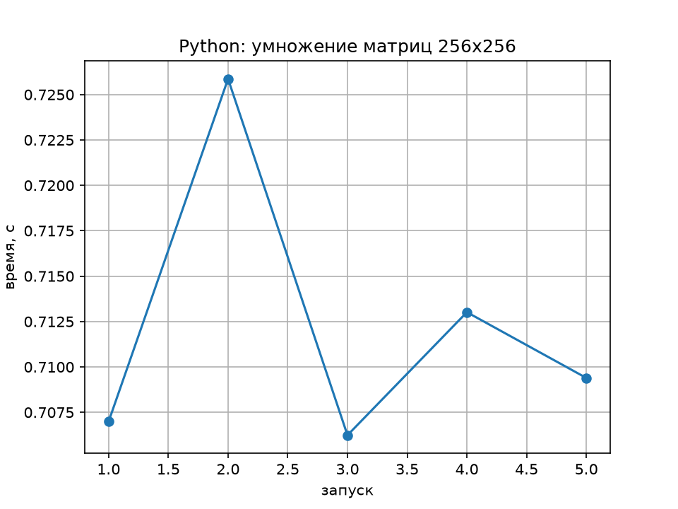

# Часть 2. Python: умножение матриц

## Реализация

В файле `student.py` реализована функция `matmul(a, b)`, возвращающая произведение двух квадратных матриц. Использован классический алгоритм с тремя вложенными циклами и сложностью $O(n^3)$.

Для измерений использованы `bench.py` и `plot_python.py` из задания преподавателя без изменений.

## Результаты измерений

Размер матриц: **256 × 256**. Количество запусков: **5**.

| Запуск | Время, с | Производительность, GFLOPS |
|---:|---:|---:|
| 1 | 0,706996 | 0,047461 |
| 2 | 0,725862 | 0,046227 |
| 3 | 0,706240 | 0,047511 |
| 4 | 0,713013 | 0,047060 |
| 5 | 0,709393 | 0,047300 |

**Медианное время:** 0,709393 с (округлённо 0,709 с).

**Производительность по медианному времени:** около 0,0473 GFLOPS.

Исходные данные измерений находятся в `python-matmul.csv`.

## Ответы на вопросы

**Почему оценка для n = 1024 получается умножением на 64?**

У классического алгоритма умножения матриц три вложенных цикла, поэтому число операций растёт пропорционально $n^3$. При увеличении размера с 256 до 1024 каждая размерность увеличивается в 4 раза, а объём вычислений — в $4^3 = 64$ раза. Оценка времени: $0{,}709393 \cdot 64 \approx 45{,}4$ с. Это приближённая оценка, а не замер.

**Сколько операций делает умножение матриц 1024 × 1024?**

По приближённой формуле из `bench.py`: $2n^3 = 2 \cdot 1024^3 = 2\,147\,483\,648$ операций с плавающей точкой (умножений и сложений). Если считать точное число арифметических операций классического алгоритма — $n^3$ умножений и $n^2(n-1)$ сложений, то всего $2\,146\,435\,072$ операций.
