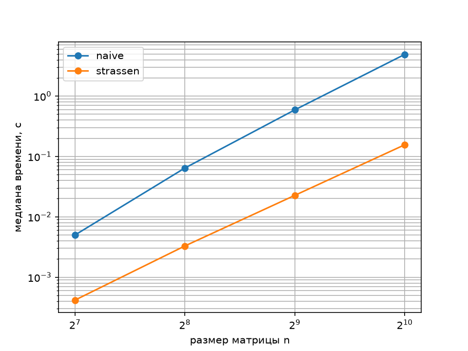

# Практическая работа № 1 — часть 1.5. Алгоритм Штрассена

## Цель

Реализовать рекурсивное умножение квадратных матриц алгоритмом Штрассена на языке C, проверить результат относительно классического умножения и сравнить время выполнения.

## Реализация и методика

- Исходный код: [`strassen.c`](strassen.c).
- В алгоритме Штрассена используются семь рекурсивных произведений блоков матриц. Для небольших блоков (64 × 64 и менее) применяется обычное умножение.
- Компиляция: `gcc -O2 strassen.c -o strassen -lm`.
- Размеры матриц: 128, 256, 512 и 1024.
- Для каждого размера проведено по пять запусков классического алгоритма (`naive`) и алгоритма Штрассена (`strassen`).
- В таблице приведена медиана времени пяти запусков. Ускорение рассчитано как отношение медианного времени `naive` к медианному времени `strassen`.
- Исходные результаты: [`strassen.csv`](strassen.csv).

## Результаты измерений

| Размер матрицы | Naive, с | Strassen, с | Ускорение |
|---:|---:|---:|---:|
| 128 × 128 | 0,004996 | 0,000417 | 11,98× |
| 256 × 256 | 0,064331 | 0,003291 | 19,55× |
| 512 × 512 | 0,591283 | 0,022678 | 26,07× |
| 1024 × 1024 | 4,905836 | 0,156096 | 31,43× |

График построен по медианам пяти запусков для каждого размера матрицы, с логарифмическими осями.

## Проверка правильности

В программе используется сравнение результата Штрассена с эталонным классическим умножением по максимальному абсолютному расхождению `maxdiff`.

| Размер матрицы | Максимальное значение maxdiff |
|---:|---:|
| 128 | 7,816 × 10⁻¹⁴ |
| 256 | 2,984 × 10⁻¹³ |
| 512 | 1,222 × 10⁻¹² |
| 1024 | 6,366 × 10⁻¹² |

Все измеренные расхождения меньше установленного порога **10⁻⁶**.

## Вывод

В проведённом эксперименте алгоритм Штрассена работал быстрее эталонной реализации `naive` на всех четырёх размерах матриц. Ускорение увеличилось с **11,98×** при размере 128 × 128 до **31,43×** при размере 1024 × 1024. При этом точность вычислений соответствует требованию `maxdiff < 10⁻⁶`.

Результаты характеризуют именно сравниваемые реализации и условия измерения; их нельзя считать универсальным ускорением алгоритма Штрассена относительно любой реализации обычного умножения матриц.
